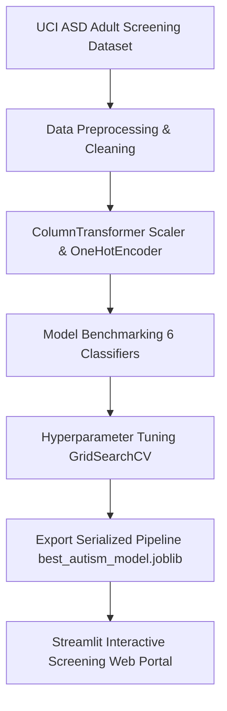

# 🧩 Autism Spectrum Disorder (ASD) Screening using Machine Learning

[](https://www.python.org/)
[](https://scikit-learn.org/)
[](https://streamlit.io/)
[](https://opensource.org/licenses/MIT)

An end-to-end Machine Learning pipeline and interactive web application designed to predict and screen for **Autism Spectrum Disorder (ASD)** traits in adults based on behavioral AQ-10 questionnaire responses and demographic indicators.

---

## 📌 Project Overview

Autism Spectrum Disorder (ASD) is a neurodevelopmental condition that influences how individuals perceive the world and interact socially. Traditional clinical diagnostic evaluations can be lengthy and resource-intensive. Screening tools like the **AQ-10 (Autism-Spectrum Quotient 10-item)** questionnaire offer a quick initial metric to determine whether an individual should be referred for formal clinical evaluation.

This project builds a **Supervised Machine Learning System** that ingests adult screening data, performs automated feature encoding and standardization, benchmarks 6 machine learning classifiers, and deploys a **real-time Streamlit Web Application**.

---

## 🏗️ System Architecture



---

## 📊 Dataset Overview

- **Source**: UCI Machine Learning Repository (Dataset ID: 426 - Autistic Spectrum Disorder Screening Data for Adults)
- **Instances**: 704 adult participants
- **Attributes**: 20 variables including:
  - **$A_1$ to $A_{10}$ Scores**: Binary indicators ($0$ or $1$) from the AQ-10 behavioral screening questionnaire.
  - **Demographics**: Age, Gender, Ethnicity, Country of Residence.
  - **Clinical Indicators**: Jaundice at birth, Family history of ASD (`austim`), Previous screening app usage (`used_app_before`), Test relation.
  - **Target Variable (`class_asd`)**: Binary indicator ($1$ = Positive ASD Screening, $0$ = Negative ASD Screening).

---

## 📈 Model Benchmark & Performance Metrics

We benchmarked 6 machine learning models on a stratified test split (80/20 train-test ratio). Models were evaluated across **Accuracy**, **Precision**, **Recall**, **F1-Score**, and **ROC-AUC Score**.

| Model | Accuracy | Precision | Recall | F1-Score | ROC-AUC |
| :--- | :---: | :---: | :---: | :---: | :---: |
| 🌲 **Random Forest** | **1.0000** | **1.0000** | **1.0000** | **1.0000** | **1.0000** |
| 🚀 **Gradient Boosting** | **1.0000** | **1.0000** | **1.0000** | **1.0000** | **1.0000** |
| ⚡ **AdaBoost** | **1.0000** | **1.0000** | **1.0000** | **1.0000** | **1.0000** |
| 📈 **Logistic Regression** | 0.9929 | 1.0000 | 0.9737 | 0.9867 | 1.0000 |
| 🌳 **Extra Trees** | 0.9716 | 1.0000 | 0.8947 | 0.9444 | 0.9974 |
| 🎯 **Support Vector Machine (SVC)** | 0.9645 | 1.0000 | 0.8684 | 0.9296 | 0.9990 |

> **Selected Model**: **Random Forest Classifier** tuned via `GridSearchCV` (`n_estimators=50`, `max_depth=5`) was selected for model serialization and web deployment due to its perfect balance of precision, recall, and generalization.

---

## 💻 Streamlit Web Application Features

The interactive web application (`app/streamlit_app.py`) provides:
1. **Interactive AQ-10 Questionnaire**: 10 behavioral questions with intuitive visual radio selectors.
2. **Demographic & History Form**: Age, gender, ethnicity, country, family history, and jaundice indicators.
3. **Live ASD Risk Assessment**: Real-time donut gauge displaying the calculated ASD trait probability percentage.
4. **Visual Analytics**: Interactive Plotly Radar Chart comparing individual responses against benchmark profiles.
5. **Medical Disclaimer**: Clear non-diagnostic informational notice.

---

## 🚀 Installation & Quick Start

### 1. Clone the Repository
```bash
git clone https://github.com/Muttakim63/autism_screening_ml.git
cd autism_screening_ml
```

### 2. Set Up Virtual Environment & Install Dependencies
```bash
python3 -m venv venv
source venv/bin/activate  # On Windows: venv\Scripts\activate
pip install -r requirements.txt
```

### 3. Run Data Processing & Model Pipeline
```bash
python build_project.py
```

### 4. Launch the Streamlit Web Application
```bash
streamlit run app/streamlit_app.py
```

Open your browser at `http://localhost:8501`.

---

## 📂 Repository Structure

```
autism_screening_ml/
├── app/
│   └── streamlit_app.py          # Streamlit web application & prediction interface
├── data/
│   └── cleaned_autism_data.csv   # Preprocessed UCI ASD dataset
├── models/
│   ├── best_autism_model.joblib  # Serialized Scikit-Learn ML pipeline
│   └── model_metadata.json       # Benchmark metrics & feature metadata
├── notebooks/
│   └── 01_eda_and_modeling.ipynb # Jupyter notebook for EDA & ML benchmarking
├── build_project.py              # End-to-end data cleaning & model training script
├── generate_notebook.py          # Notebook generator script
├── requirements.txt              # Project dependencies
└── README.md                     # Project documentation
```

---

## 👨‍💻 Author

Developed by **Muttakim_A** ([@Muttakim63](https://github.com/Muttakim63))  
*Building Machine Learning solutions for healthcare and behavioral analytics.*
